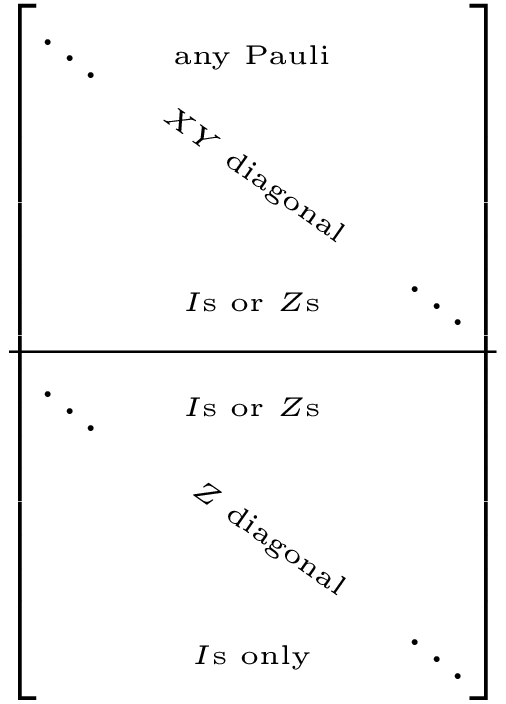
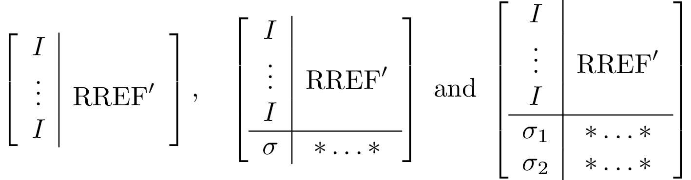
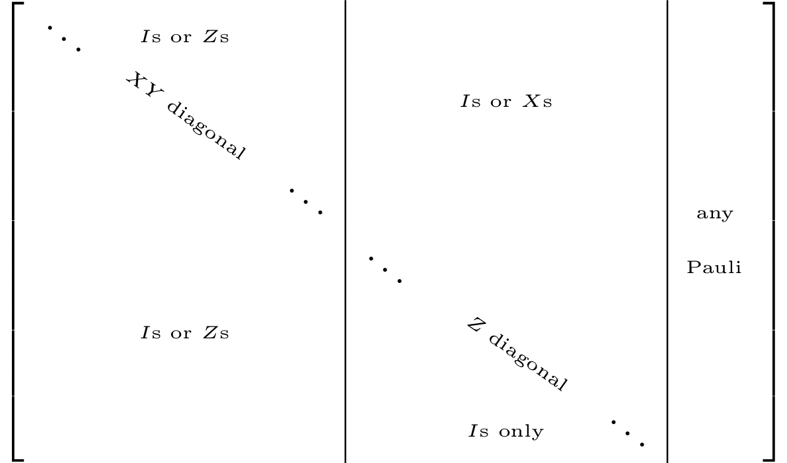

# Canonicalization operations

The tableau canonicalization routines below use Gaussian elimination. [`lc_to_css`](@ref)
also finds single-qubit Clifford gates that expose CSS structure.

## Conversion to CSS form

[`lc_to_css`](@ref) decides whether a stabilizer code is locally Clifford-equivalent
to a Calderbank–Shor–Steane (CSS) code. It returns an independent, signed CSS
`Stabilizer` and a vector of [`SingleQubitOperator`](@ref)s, or `nothing` if no
such local transformation exists. The input is not modified. Each returned check
contains only X and I or only Z and I.

Generator changes can hide CSS structure even without a change of local basis.
For example, `+YY` and `+ZZ` generate the pure checks `-XX` and `+ZZ`. Row reduction
recovers those signs, and the conversion circuit is empty. More generally, the
routine solves at most two affine binary systems per independent qubit component
to find suitable local bases, then performs signed row reduction.

```jldoctest
julia> original = S"XZ
                    ZX";

julia> css, circuit = lc_to_css(original);

julia> css
+ XX
+ ZZ

julia> converted = copy(original);

julia> for gate in circuit
           apply!(converted, gate)
       end

julia> canonicalize!(converted) == css
true

julia> lc_to_css(S"XZZXI
                  IXZZX
                  XIXZZ
                  ZXIXZ") === nothing # the five-qubit code has no CSS representative
true
```

The returned circuit maps the input code space to the output code space;
row operations only change its generating set. The CSS representative is not
unique and need not match the CSS basis used to construct a scrambled input.
Generator signs are retained rather than normalized to positive signs.
Redundant checks, codes with logical qubits, disconnected code blocks, and unused
qubits are supported. This implementation returns a reduced basis; it does not
guarantee that the output checks preserve the sparsity of the supplied generators.

## [`canonicalize!`](@ref)

First do elimination on all X components and only then perform elimination on
the Z components. Based on [garcia2012efficient](@cite).
It is used in [`logdot`](@ref) for inner products of stabilizer states.

The final tableaux, if square should look like the following


If the tableaux is shorter than a square, the diagonals might not reach all the way to the right.

```@example
using QuantumClifford, CairoMakie
f=Figure()
stabilizerplot_axis(f[1,1], canonicalize!(random_stabilizer(20,30)))
f
```

## [`canonicalize_rref!`](@ref)

Cycle between elimination on X and Z for each qubit. Particularly useful for
tracing out qubits. Based on [audenaert2005entanglement](@cite).
For convenience reasons, the canonicalization starts from the bottom row,
and you can specify as a second argument which columns to be canonicalized
(useful for tracing out arbitrary qubits, e.g., in [`traceout!`](@ref)).

The tableau canonicalization is done in recursive steps, each one of which results in something akin to one of these three options


```@example
using QuantumClifford, CairoMakie
f=Figure()
stabilizerplot_axis(f[1,1], canonicalize_rref!(random_stabilizer(20,30),1:30)[1])
f
```

## [`canonicalize_gott!`](@ref)

First do elimination on all X components and only then perform elimination on
the Z components, but without touching the qubits that were eliminated during
the X pass.
Unlike other canonicalization operations, qubit columns are reordered,
providing for a straight diagonal in each block.
Particularly useful as certain blocks of the new created matrix are
related to logical operations of the corresponding code,
e.g. computing the logical X and Z operators of a [`MixedDestabilizer`](@ref).
Based on [gottesman1997stabilizer](@cite).

A canonicalized tableau would look like the following (the right-most block does
not exist for square tableaux).


```@example
using QuantumClifford, CairoMakie
f=Figure()
stabilizerplot_axis(f[1,1], canonicalize_gott!(random_stabilizer(30))[1])
f
```

## [`canonicalize_clip!`](@ref)

Convert to the "clipped" gauge of a stabilizer state resulting in a "river" of non-identity operators around the diagonal.

```@example
using QuantumClifford, CairoMakie
f=Figure()
stabilizerplot_axis(f[1,1], canonicalize_clip!(random_stabilizer(30)))
f
```

The properties of the clipped gauge are:

1. Each qubit is the left/right "endpoint" of exactly two stabilizer rows.
2. For the same qubit the two endpoints are always different Pauli operators.

This canonicalization is used to derive the [`bigram`](@ref) a stabilizer state,
which is also related to entanglement entropy in the state.

Introduced in [nahum2017quantum](@cite), with a more detailed explanation of the algorithm in Appendix A of [li2019measurement](@cite).
